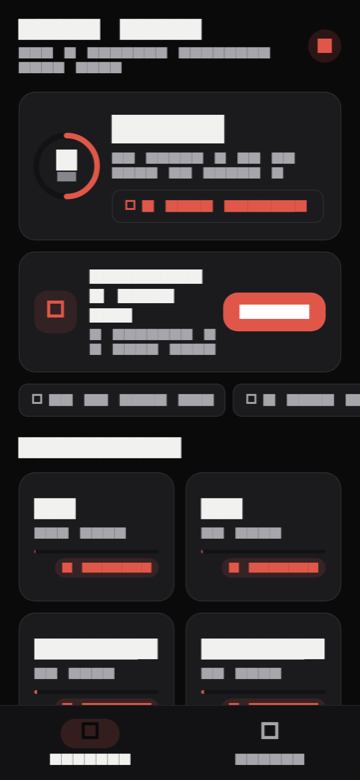
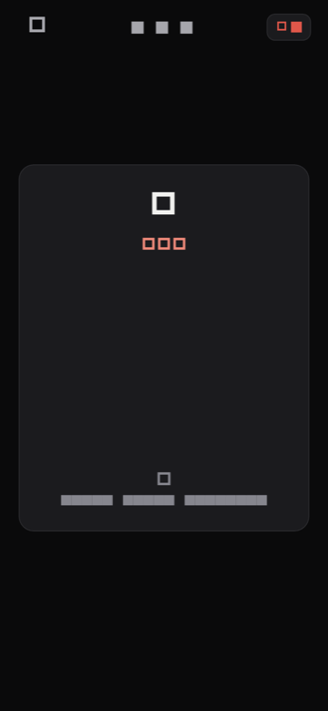
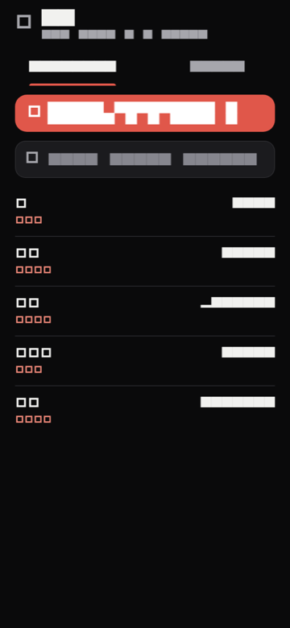
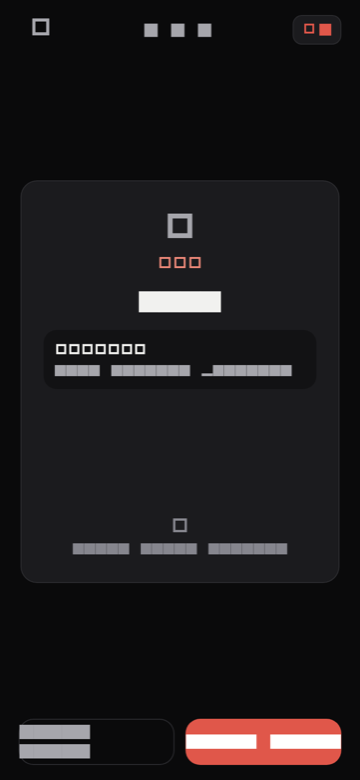
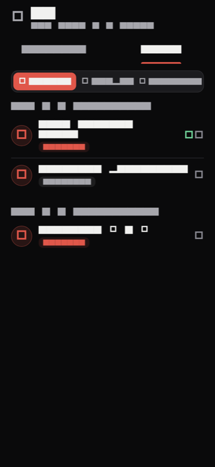
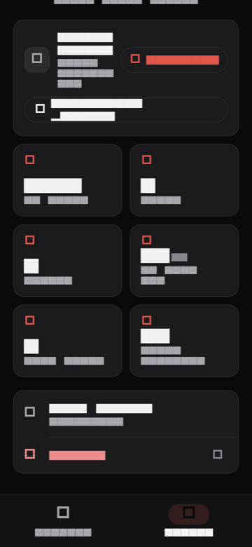

<div align="center">

# Zest

**Belajar bahasa Jepang lewat flashcard SRS dan video lesson.**
Sesi singkat beberapa menit sehari, jalan tanpa internet, progres tersimpan ke akun Google.


</div>

Zest adalah aplikasi mobile-first untuk latihan kosakata bahasa Jepang. Dua bagian utamanya: **flashcard dengan penjadwalan SRS** dan **video lesson per bab**. Ada sistem XP, level, dan streak harian sebagai pengingat.

Semua progres disimpan di perangkat dulu, baru dikirim ke server. Jadi belajar tetap bisa saat koneksi jelek, dan pindah perangkat tidak kehilangan riwayat.

## 📸 Tampilan

| Beranda | Flashcard | Kategori |
|:---:|:---:|:---:|
|  |  |  |
| Ringkasan hari ini, XP, streak | Kartu kata + bacaan | Daftar kosakata + pencarian |

| Jawab kartu | Video per bab | Profil |
|:---:|:---:|:---:|
|  |  |  |
| Arti, contoh kalimat | Playlist + filter tipe | Statistik & sinkronisasi |

> Screenshot di atas bukan mockup — di-render dari widget asli lewat golden test (`test/screenshot_test.dart`). Regenerate dengan `SCREENSHOTS=1 flutter test test/screenshot_test.dart --update-goldens`.

## Fitur

**Belajar**
- Flashcard SRS: kartu dibalik 3D (kata + bacaan → arti + contoh kalimat), jawab *Sudah hafal* / *Belum hafal*. Interval makin panjang tiap kali benar, kartu yang salah diulang di akhir sesi.
- Audio pengucapan offline: MP3 hasil VOICEVOX di-bundle di app (~10 MB), tidak butuh server. Bacaan tanpa audio otomatis tidak menampilkan tombol.
- Video lesson per kategori dan bab, filter Gabung / Bunpou / Kosakata, tanda "lanjut menonton" dari posisi terakhir.

**Progres**
- XP per jawaban benar, level, dan streak harian. Ringkasan tiap sesi dengan konfeti kalau naik level.
- Semua data lokal disimpan per-akun (SharedPreferences), jadi beberapa user di satu perangkat tidak saling menimpa.

**Akun**
- Login lewat Google. Web pakai One Tap / tombol GIS dan sesi bertahan 1 hari lewat session token; mobile masuk langsung ke Beranda dari profil tersimpan tanpa muncul layar login.
- Sinkronisasi all-or-nothing: satu request berisi stats + semua SRS + semua watched. Jalan otomatis saat app masuk background dan saat buka Profil, atau manual dari tombol.

## Teknologi

| Bagian | Dipakai |
|---|---|
| App | Flutter (Dart ^3.12) untuk Android, iOS, dan Web |
| State | `ValueNotifier` + service, tanpa framework tambahan |
| Data lokal | `shared_preferences`, key per-uid |
| HTTP | Dio, dengan retry sekali kalau token 401 tapi sudah diperbarui |
| Video | `video_player` + `chewie` |
| Login | `google_sign_in` (native), Google Identity Services (web) |
| Backend | Node 20, serverless function di Vercel (tanpa Express) |
| Database | Turso (libSQL), satu shard per user |
| Verifikasi | Google ID token via JWKS (`jose`), session token HS256 |

## Menjalankan

Butuh: Flutter SDK, Node 20+, client ID OAuth Google, database Turso.

```bash
git clone https://github.com/ChrisandyWiranata/zest.git
cd zest
flutter pub get
cp .env.example .env     # isi GOOGLE_*_CLIENT_ID (nilai publik, bukan secret)
flutter run
```

Backend, di terminal lain:

```bash
cd backend
npm ci
cp .env.example .env.local   # isi TURSO_URL + TURSO_TOKEN (gitignored)
npm run serve                # http://localhost:3000
```

## Perintah

| Perintah | Keterangan |
|---|---|
| `dart format lib test` | Rapikan format |
| `flutter analyze` | Analysis; targetnya nol issue |
| `flutter test` | Seluruh unit & widget test |
| `npm test` | Test unit backend |
| `npm run smoke` | Test integrasi backend (butuh Turso hidup) |
| `bash tool/build_web.sh` | Build web siap deploy |

Frontend di-deploy `vercel --prod` dari artefak `build/web`, backend `vercel --prod` dari folder `backend/`.

## Struktur

```
zest/
├── lib/
│   ├── features/         # auth, home, vocab, videos, categories,
│   │                     # profile, settings, users, tts, progress
│   ├── core/             # layout adaptif, tema, widget bersama, ApiClient
│   └── config/           # AppConfig, baca .env (asset publik)
├── backend/              # API serverless (Vercel)
│   ├── api/              # handler endpoint
│   └── lib/              # routes, validasi, JWKS, akses Turso
├── assets/               # audio TTS + ikon
├── test/                 # unit, widget, dan screenshot test
├── tool/                 # build_web.sh, generate_tts.py, make_logo_icons.swift
├── docs/PRODUCT_DESIGN.md
└── AGENTS.md
```

## API

Semua endpoint butuh `Authorization: Bearer <Google idToken | session token>`, kecuali `/api/health`.

| Method | Endpoint | Fungsi |
|---|---|---|
| GET | `/api/health` | Status server (publik) |
| GET | `/api/categories` | Daftar kategori |
| GET | `/api/vocab?category=` | Kosakata per kategori |
| GET | `/api/videos?category=&type=` | Video per kategori |
| POST | `/api/me/profile` | Set/ambil profil, terbitkan session token web |
| GET | `/api/me/progress?categories=` | Stats, SRS, video ditonton |
| POST | `/api/me/sync` | Sinkronisasi all-or-nothing |

Detail lebih lengkap ada di [`backend/README.md`](backend/README.md).

## Roadmap

- [ ] Cache konten (kata & video) supaya bisa dibuka penuh offline
- [ ] Posisi "lanjut menonton" yang ikut tersinkron antar perangkat
- [ ] Ikon dan splash screen sendiri
- [ ] Tinjau ulang penyimpanan token di sisi client

## Dokumen

| Dokumen | Isi |
|---|---|
| [`docs/PRODUCT_DESIGN.md`](docs/PRODUCT_DESIGN.md) | Alur produk, bentuk data, catatan desain |
| [`AGENTS.md`](AGENTS.md) | Aturan kerja, gotcha, kontrak klien–server |
| [`backend/README.md`](backend/README.md) | Referensi API dan environment |
